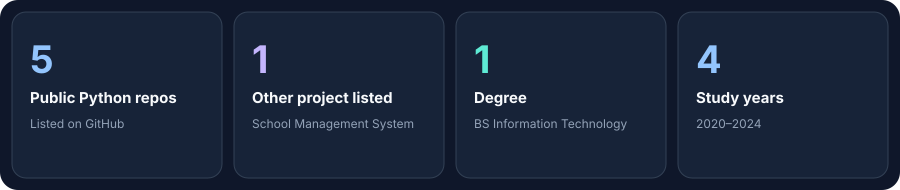

**IT Graduate | Web Development & Python**

I'm **Syyeda Maheen Bukhari**, a BS Information Technology graduate (2020–2024) interested in web development and software engineering. I work with frontend and backend technologies, databases, and development tools, and continue strengthening my skills through practical projects.

I am also part of the **PSEB Web Engineering Bootcamp**, where I am developing my technical skills through hands-on learning.

### School Management System
A project listed in my portfolio. Further description and technology details have not yet been provided.

### Python projects

- [Python Functions & Lists Assessment](https://github.com/Syedamaheen05/python-functions-lists-assessment)
- [Practice Python Functions and Strings](https://github.com/Syedamaheen05/practice-python-function-and-strings)
- [Python Conditions & Loops Assessment](https://github.com/Syedamaheen05/python-condition-loops-assessment)
- [Python Loops — Electricity Bill Calculator](https://github.com/Syedamaheen05/python-loops-electricity-bill-calculator)
- [Python Conditionals — Smart Canteen](https://github.com/Syedamaheen05/python-conditionals-smart-canteen)

### Frontend

### Backend

### Cloud & DevOps

### Databases

### Tools

- **BS Information Technology** — 2020–2024
- **PSEB Web Engineering Bootcamp** — currently listed as a learning program; dates not provided.

*Thanks for visiting my profile!*

