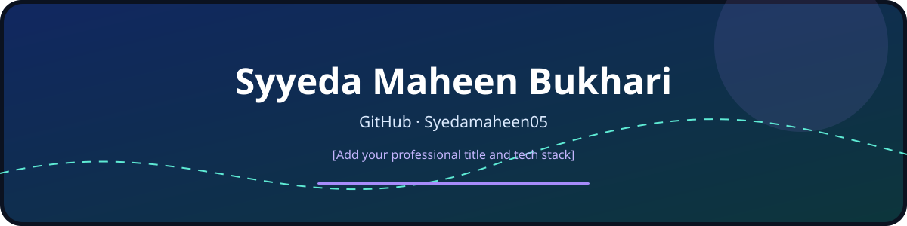
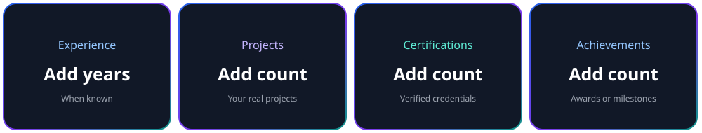

# Syyeda Maheen Bukhari

**[Add your professional title here]**

[Add a short one-line introduction here.]

## About Me

<!-- Add what you're working on, learning, interests, and opportunities you're looking for. -->

## Experience

<!-- Add roles if applicable; remove this section if you have none to include. -->
| Role | Organization | Dates | Highlights |
|---|---|---|---|
| <!-- Role --> | <!-- Organization --> | <!-- From–to --> | <!-- Contributions --> |

## Career Timeline

<!-- Optional: add career or education milestones. Remove if not needed. -->

## What I've Worked On / Projects

<!-- Add projects, descriptions, technologies, and public links. -->
### Project Name
- **Description:** <!-- What it does -->
- **Tech:** <!-- Technologies used -->
- **Link:** <!-- Repository or live demo -->

**Backend**

<!-- Add badges here. -->

**Frontend**

<!-- Add badges here. -->

**Cloud & DevOps**

<!-- Add badges here. -->

**Databases**

<!-- Add badges here. -->

**Tools**

<!-- Add badges here. -->

## Core Competencies

| Area | Competencies |
|---|---|
| <!-- Area --> | <!-- Skills or strengths --> |

## Education & Certifications

<!-- Add degrees, institutions, dates, and verified certifications. -->

## GitHub Stats

## Let's Connect

<!-- Add only contact details you explicitly want to make public. -->
- **GitHub:** [@Syedamaheen05](https://github.com/Syedamaheen05)
- **LinkedIn:** <!-- Add your URL -->
- **Portfolio:** <!-- Add your URL -->

*Thanks for visiting my profile!*

